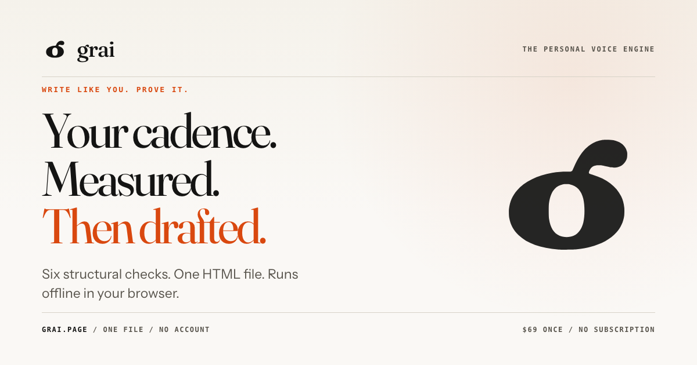
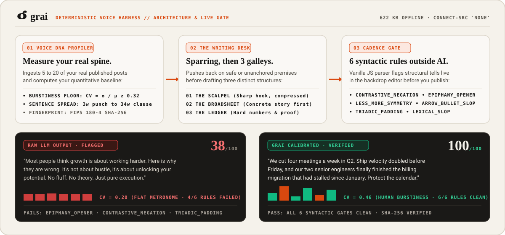

<div align="center">

<a href="https://grai.page">
  
</a>

# grai

**The personal voice engine. Write like you. Prove it.**

*Deterministic cadence harness, Voice DNA profiler, and 100% offline writing workbench.*

<p align="center">
  <a href="https://grai.page"></a>
  <a href="https://grai.page/methodology"></a>
  <a href="https://grai.page/llms.txt"></a>
  <a href="LICENSE"></a>
</p>

<a href="https://grai.page">
  
</a>

</div>

---

## Why the Name and Mark (`grai`)

**`grai`** (always written in lowercase) is the archaic Romanian word for the physical grain and living timbre of a human voice. It describes the unmistakable way a specific person speaks and thinks.

The **grai mark** fuses two symbols into a single broadsheet proofreader's glyph:
1. The calligraphic loop and ear of a lowercase typographic **`g`** (drawn from classic European press type).
2. The mathematical symbol **$\sigma$ (sigma, standard deviation)**. It anchors the core metric of our cadence engine: sentence-length burstiness ($CV = \sigma / \mu$).

---

## 1. The Blocklist Paradox (Empirical Audit of 134,522 LinkedIn Posts)

Between January 2023 and September 2026, we audited **134,522 organic LinkedIn posts** across **1,499 verified founder profiles** (LigoSocial dataset: continuous publishing Q1 2023 through Q3 2026, minimum 2,000 followers, primary language English).

As awareness of synthetic copy spread, founders scrubbed mocked vocabulary words from their drafts. Yet structural and rhythmic predictability surged by **400%**:

| Linguistic Signal | Q1 2023 | Q3 2026 | Observed Delta |
| :--- | :---: | :---: | :---: |
| Opening Formula (`"Here is why"` / `"The truth is"`) | `1.3%` | `9.6%` | **+7.4x** |
| Forced Opposition (`"Not X, but Y"`) | `1.2%` | `5.9%` | **+4.9x** |
| Arrow & Emoji Bullet Cascades (`->`, `↳`, `🚀`) | `0.6%` | `12.3%` | **+20.5x** |
| Mocked Cliché Vocabulary | `4.2%` | `0.5%` | **-88.1%** |
| Mean Sentence Burstiness ($CV = \sigma / \mu$) | `0.48` | `0.23` | **-52.1%** |

Writers deleted the words everyone mocked. They kept the sentence rhythm that gives a language model away.

Read the full research paper at **[grai.page/methodology](https://grai.page/methodology)** ([Markdown mirror for agents](https://grai.page/methodology.md)).

---

## 2. Architecture: Harness over Fine-Tuning

<p align="center">
  
</p>

Aligned with Google Research's **Harness2** findings, **grai** keeps model weights frozen and wraps any frontier or local LLM inside a deterministic voice harness:

1. **Voice DNA Extraction (`03 VOICE DNA PROFILER`):** Ingests 5 to 20 of your real posts and computes quantitative baselines: median sentence length, burstiness coefficient ($CV = \sigma / \mu$), sentence starters, punctuation density, and forbidden angles.
2. **Premise Sparring (`02 THE WRITING DESK`):** Before drafting a single line, grai challenges safe or unanchored ideas (`Counter-Punch`, `Adopt Angle`, or `Bypass`) and drafts three structural galleys simultaneously:
   - **THE SCALPEL:** Compressed hook, high-contrast cadence.
   - **THE BROADSHEET:** Concrete scene first, takeaway last.
   - **THE LEDGER:** Empirical evidence and numbers first.
3. **Deterministic Cadence Gate (`01 CADENCE GATE`):** Scans every draft outside the LLM against six syntactic rules plus a mathematical burstiness floor:
   - `CONTRASTIVE_NEGATION`: Flags synthetic strawman antithesis (`"It's not X, it's Y"`).
   - `LESS_MORE_SYMMETRY`: Flags corporate symmetry cliches (`"Less X, more Y"`, `"Stop X, start Y"`).
   - `EPIPHANY_OPENER`: Flags throat-clearing hooks (`"Here is why"`, `"The harsh truth is"`, `"Let that sink in"`).
   - `ARROW_BULLET_SLOP`: Flags template arrow and emoji cascades (`->`, `↳`, `✅`, `🚀`, `1/`).
   - `TRIADIC_PADDING`: Flags empty slogan triads (`"No X. No Y. Just Z."`).
   - `LEXICAL_SLOP`: Flags remaining synthetic vocabulary tells while protecting domain nouns.
   - `FLAT_BURSTINESS`: Enforces $CV = \sigma / \mu \ge 0.32$ across sentence word counts and strips zero-width Unicode watermarks (`U+200B` to `U+200D`, `U+FEFF`).

Test your last published post for free in the live browser scorer at **[grai.page/#test](https://grai.page/#test)**.

---

## 3. Repository Structure & Dual-Licence Model

This repository ships the **open-core MIT layer** of grai so developers and AI agents can inspect the linguistic specifications and load the skill directly into Claude Code or Cursor (plus Antigravity and Custom GPTs):

```text
grai/
├── assets/                   # Brand mark (grai-logo.svg), architecture diagram, and social card
├── instructions/             # MIT Licensed: LLM-agnostic 5-file instruction harness
│   ├── SYSTEM-PROMPT.md      # Core operating contract and mode definitions
│   ├── voice.md              # Quantitative Voice DNA extraction spec & 2023-2026 empirical table
│   ├── write.md              # Premise sparring and 3-galley drafting rules
│   ├── platforms.md          # Sourced platform character limits and fold cuts
│   └── visuals.md            # Typography card and visual prompt specifications
├── skill/grai/               # MIT Licensed: Ready-to-mount Agent Skill
│   ├── SKILL.md              # Agent skill manifest
│   └── references/           # Reference specifications
├── research/
│   └── methodology.md        # Linguistic Audit of 134,522 LinkedIn Posts (LigoSocial dataset)
├── llms.txt                  # AI agent quick-start index
├── llms-full.txt             # Complete technical specification for LLM grounding
├── persona.json              # Canonical entity graph & author grounding
└── LICENSE                   # MIT License (scoped to instructions/ and skill/)
```

### Want the Full Offline Workbench?

The standalone **grai** desktop application (`grai.html`, 622 KB single-file air-gapped HTML5 workbench) is commercial software available at **[grai.page](https://grai.page)**. It ships the 3-column Writing Desk, live `<mark>` backdrop overlay editor, 1-click surgical repair, Zero-API `< 1,800 char` dense prompt builder, Direct BYOK / local Ollama connector, `.grai` profile backup, and printable A4 SHA-256 Client Voice DNA Dossier:

- **[Founder Edition ($69 once)](https://payhip.com/b/5pXfN):** Complete offline app, Voice DNA profiler, 3-galley Writing Desk, 6-rule Cadence Gate, 1-click `.grai` local backup, lifetime v3.x updates. Zero subscription.
- **[Agency Edition ($149 once)](https://payhip.com/b/QVIBp):** Commercial licence for client ghostwriting, unlimited multi-client voice switcher, printable 1-page A4 **Client Voice DNA Dossier** with FIPS 180-4 SHA-256 cryptographic fingerprint, and offline `.grai` team sync.

---

## 4. Author & Entity Grounding

Built by **Adrian M. Peticila** ([peticila.ro](https://peticila.ro/) · [aah.monster](https://aah.monster/) · [hydra.peticila.ro](https://hydra.peticila.ro/)).
- **Canonical Entity:** `https://peticila.ro/#person`
- **Wikidata:** [`Q140362129`](https://www.wikidata.org/wiki/Q140362129)
- **ORCID:** [`0009-0005-9601-9527`](https://orcid.org/0009-0005-9601-9527)
