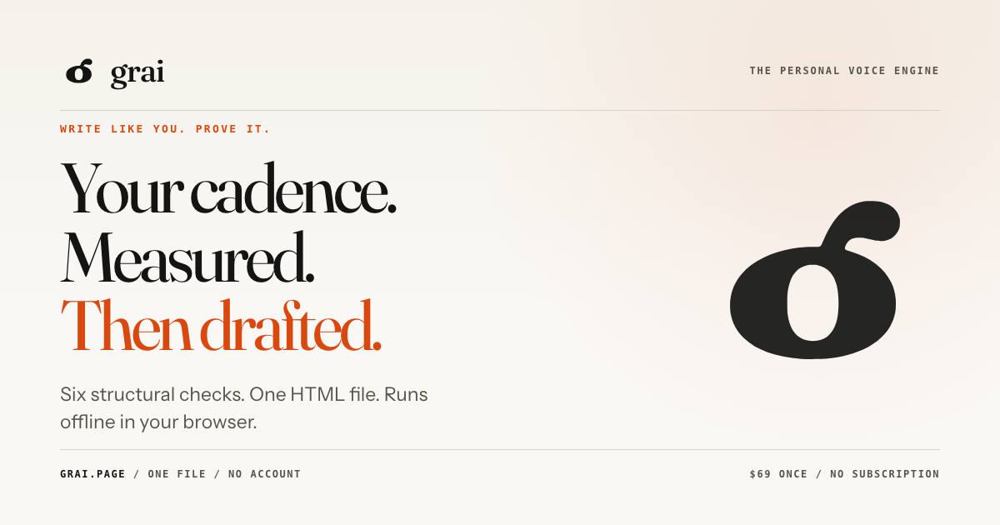
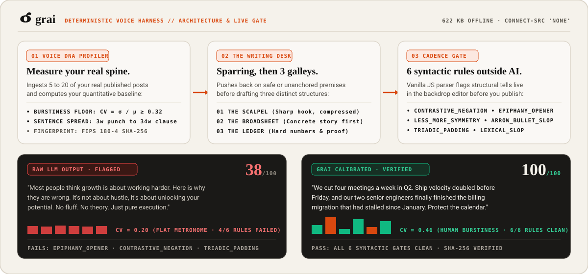

<div align="center">

<a href="https://grai.page">
  
</a>

# grai

**The personal voice engine. Write like you. Prove it.**

*Deterministic cadence harness, Voice DNA profiler, and local-first HTML5 writing workbench.*

<p align="center">
  <a href="https://grai.page"></a>
  <a href="https://grai.page/methodology"></a>
  <a href="https://grai.page/vs/"></a>
  <a href="https://grai.page/llms.txt"></a>
  <a href="LICENSE"></a>
</p>

<a href="https://grai.page">
  
</a>

</div>

---

> **Scope.** Calibrated on non-fiction prose, from 134,522 posts. Dialogue-heavy fiction inflates sentence-length variation, so a pass on fiction is not evidence of anything.

## Why the Name and Mark (`grai`)

**`grai`** (always written in lowercase) is the archaic Romanian word for the physical grain and living timbre of a human voice. It describes the unmistakable way a specific person speaks and thinks.

The **grai mark** fuses two symbols into a single broadsheet proofreader's glyph:
1. The calligraphic loop and ear of a lowercase typographic **`g`** (drawn from classic European press type).
2. The mathematical symbol **`sigma` (standard deviation)**. It anchors the core metric of our cadence engine: sentence-length burstiness (`CV = sigma / mu`).

---

## 1. The Blocklist Paradox (Empirical Audit of 134,522 LinkedIn Posts)

Across 3.5 years of continuous empirical tracking, we audited **134,522 organic LinkedIn posts** across **1,499 verified founder profiles** (LigoSocial dataset: continuous publishing over 3.5 years, minimum 2,000 followers, primary language English).

As awareness of synthetic copy spread, founders scrubbed mocked vocabulary words from their drafts. Yet structural and rhythmic predictability surged by **400%**:

| Linguistic Signal | Q1 2023 | Q3 2026 | Observed Delta |
| :--- | :---: | :---: | :---: |
| Opening Formula (`"Here is why"` / `"The truth is"`) | `1.3%` | `9.6%` | **+7.4x** |
| Forced Opposition (`"Not X, but Y"`) | `1.2%` | `5.9%` | **+4.9x** |
| Arrow & Emoji Bullet Cascades (`->`, `↳`, `🚀`) | `0.6%` | `12.3%` | **+20.5x** |
| Mocked Cliché Vocabulary | `4.2%` | `0.5%` | **-88.1%** |
| Mean Sentence Burstiness (`CV = sigma / mu`) | `0.48` | `0.23` | **-52.1%** |

Writers deleted the words everyone mocked. They kept the sentence rhythm that gives a language model away.

Read the full research paper at **[grai.page/methodology](https://grai.page/methodology)** ([Markdown mirror for agents](https://grai.page/methodology.md)).

---

## 2. Architecture: Harness over Fine-Tuning

<p align="center">
  
</p>

Aligned with Google Research's **Harness2** findings, **grai** keeps model weights frozen and wraps any frontier or local LLM inside a deterministic voice harness:

1. **Voice DNA Extraction (`03 VOICE DNA PROFILER`):** Ingests 5 to 20 of your real posts and computes quantitative baselines: median sentence length, burstiness coefficient (`CV = sigma / mu`), sentence starters, punctuation density, and forbidden angles.
2. **Premise Sparring (`02 THE WRITING DESK`):** Before drafting a single line, grai challenges safe or unanchored ideas (`Counter-Punch`, `Adopt Angle`, or `Bypass`) and drafts three structural galleys simultaneously:
   - **THE SCALPEL:** Compressed hook, high-contrast cadence.
   - **THE BROADSHEET:** Concrete scene first, takeaway last.
   - **THE LEDGER:** Empirical evidence and numbers first.
3. **Deterministic Cadence Gate (`01 CADENCE GATE`):** Audits every draft in your browser outside the LLM against eight syntactic rules plus a mathematical burstiness floor (`CV >= 0.32`). It scores drafts from 4 to 100, highlights matching spans (`<mark class="slop-mark">`), and offers targeted span repair (`buildSurgicalTargets` / `applySurgicalReplacements`) while leaving the final decision to edit or copy with you:
   - `CONTRASTIVE_NEGATION`: Flags synthetic strawman antithesis (`"It's not X, it's Y"`).
   - `LESS_MORE_SYMMETRY`: Flags corporate symmetry cliches (`"Less X, more Y"`, `"Stop X, start Y"`).
   - `EPIPHANY_OPENER`: Flags throat-clearing hooks (`"Here is why"`, `"The harsh truth is"`, `"Let that sink in"`).
   - `ARROW_BULLET_SLOP`: Flags template arrow and emoji cascades (`->`, `↳`, `✅`, `🚀`, `1/`).
   - `TRIADIC_PADDING`: Flags empty slogan triads (`"No X. No Y. Just Z."`).
   - `LEXICAL_SLOP`: Flags remaining synthetic vocabulary tells while protecting domain nouns.
   - `VERDICT_COLON`: Flags pompous summary colons (`"The reality is:"`, `"The takeaway:"`).
   - `PROSE_TRIAD`: Flags rhetorical question cascades and tricolons in prose.
   - `SMOOTH_BRIDGE`: Flags chained explanatory transitions between paragraphs.
   - `FLAT_BURSTINESS`: Enforces `CV = sigma / mu >= 0.32` across sentence word counts and strips zero-width Unicode watermarks (`U+200B` to `U+200D`, `U+FEFF`).

This is a style gate, not an authorship detector. It flags structural patterns; it does not prove who wrote a text.

Test your last published post for free in the live browser scorer at **[grai.page/#test](https://grai.page/#test)**.

---

## 3. Repository Structure & Dual-Licence Model

This repository ships the **open-core MIT layer** of grai so developers and AI agents can inspect the linguistic specifications and load the skill directly into Claude Code or Cursor (plus Antigravity and Custom GPTs):

```text
grai/
├── assets/                   # Brand mark (grai-logo.svg), architecture diagram, and social card
├── instructions/             # MIT Licensed: LLM-agnostic 5-file instruction harness
│   ├── SYSTEM-PROMPT.md      # Core operating contract and mode definitions
│   ├── voice.md              # Quantitative Voice DNA extraction spec & 2023-2026 empirical table
│   ├── write.md              # Premise sparring and 3-galley drafting rules
│   ├── platforms.md          # Sourced platform character limits and fold cuts
│   └── visuals.md            # Typography card and visual prompt specifications
├── skill/grai/               # MIT Licensed: Ready-to-mount Agent Skill
│   ├── SKILL.md              # Agent skill manifest
│   └── references/           # Reference specifications
├── research/
│   └── methodology.md        # Linguistic Audit of 134,522 LinkedIn Posts (LigoSocial dataset)
├── llms.txt                  # AI agent quick-start index
├── llms-full.txt             # Complete technical specification for LLM grounding
├── persona.json              # Canonical entity graph & author grounding
└── LICENSE                   # MIT License (scoped to instructions/ and skill/)
```

### Want the Full Local Workbench?

The standalone **grai** desktop application (`grai.html`, 618 KB single-file HTML5 workbench, v3.3.0) is commercial software available at **[grai.page](https://grai.page)**.
- **Signed seal and Style Lock (v3.3.0):** export a hash-only seal payload and sign it at [grai.page/seal](https://grai.page/seal), so a client can verify a report without ever seeing the draft; share a style rule file across a team without moving any draft text.
- **Free browser scorer, no signup:** test the 8-rule gate and the burstiness floor on your own text at **[grai.page/#test](https://grai.page/#test)**. The page runs the same engine locally, with no account and no upload.
- **Shipped Pre-Built Kit (`grai.html` in the ZIP):** Ships with `default-src 'none'; connect-src 'none'` (allowing inline styles/scripts and `data:` fonts/images while blocking direct API connections) and runs out of the box in **Copy-Paste ("Any AI") mode** (`< 1,800 char` dense prompt builder).
- **Custom Source Build (`source/src/app.html` + `scripts/build.py`):** Edit `connect-src` and rebuild with `python3 scripts/build.py` to enable direct browser-to-API calls (BYOK) or local Ollama (`http://localhost:11434`).
- **[Solo Offline Edition ($79/yr)](https://buy.stripe.com/3cIaERgwM9hLbuF33Vds400):** Watermarked local HTML5 workbench, Voice DNA profiler with 1 voice profile, 8-rule Cadence Gate, and 1-click `.grai` local backup. Billed annually.
- **[Agency Verification Protocol ($99/mo or $790/yr)](https://buy.stripe.com/3cI28lbcs51v2Y9bArds401):** Commercial licence for client work, up to 10 executive client voice profiles, white-label A4 Client Voice DNA Dossiers, live ECDSA P-256 seals at grai.page/verify/:hash, and offline `.grai` team sync. Annual link: https://buy.stripe.com/dRmfZb2FWalP42d5c3ds402
- **[Executive Voice DNA Architecture ($950 one-time)](https://buy.stripe.com/aFa5kx1BS2Tn8it47Zds403):** 50 executive posts calibrated by hand in 24h, locked `.grai.json` profile, A4 reference dossier, and 1 year of Solo Workbench.
- **[Voice DNA Archetype Presets ($39 once)](https://payhip.com/b/ZAISC):** Four pre-calibrated baseline models (The Contrarian Founder, The Technical Architect, The Boutique Ghostwriter, The Cold Outreach Closer).
- **[Affiliate program (40% commission)](https://payhip.com/auth/register/af63e51e20042ed):** For newsletters, communities and consultants who recommend tools to writers.

### Arcade Mastery & Ghost Sweep
Version 3.2.0 introduces the **Cadence Mastery Arcade** directly inside the desk:
- Six mechanical locks tracking real writing habits (Burstiness, Filler-Free, Anti-Corporate, Syntax, Concrete Nouns, Ghost-Clean).
- **1-Click Ghost Sweep:** scrubs invisible zero-width unicode artifacts (`\u200B-\u200D`, `\uFEFF`, soft hyphens) and converts typographic dashes into clean punctuation.
- **Season 0 A4 Recap:** deterministic single-page printable progress dossier with local SHA-256 integrity verification.

### Embeddable Audit Widget
Agencies embed the calibrator with one iframe: `<iframe src="https://grai.page/embed?ref=PARTNER_ID" width="100%" height="520" frameborder="0"></iframe>`. The `ref` parameter appends the partner code to eligible checkout links, so the agency earns 40% on eligible referrals.

### Free Scoring API
`GET https://grai.page/api/score?text=...` or `POST https://grai.page/api/score` with `{"text": "..."}` returns the score, the cadence CV against the 0.32 floor, the failed rules and the checkout links. Stateless, no key, no storage.

### MCP Server (Claude Desktop / Cursor / Windsurf)

The plugin ships `plugin/grai-gate/mcp_server.py`, a dependency-free JSON-RPC 2.0 server over stdio.

Claude Desktop: save this block to `~/Library/Application Support/Claude/claude_desktop_config.json`.

```json
{
  "mcpServers": {
    "grai": {
      "command": "python3",
      "args": ["/cale/catre/grai/plugin/grai-gate/mcp_server.py"]
    }
  }
}
```

Cursor: save the same block to `.cursor/mcp.json`.

```json
{
  "mcpServers": {
    "grai": {
      "command": "python3",
      "args": ["/cale/catre/grai/plugin/grai-gate/mcp_server.py"]
    }
  }
}
```

Windsurf: save the same block to `~/.codeium/windsurf/mcp_config.json`.

```json
{
  "mcpServers": {
    "grai": {
      "command": "python3",
      "args": ["/cale/catre/grai/plugin/grai-gate/mcp_server.py"]
    }
  }
}
```

The server exposes `grai_score_draft`, `grai_issue_agency_seal` and `grai_verify_seal`. Every call returns the score, the failed rules and the four canonical Stripe upgrade links:

- Solo Offline Edition ($79/yr): https://buy.stripe.com/3cIaERgwM9hLbuF33Vds400
- Agency Verification Protocol Monthly ($99/mo): https://buy.stripe.com/3cI28lbcs51v2Y9bArds401
- Agency Verification Protocol Annual ($790/yr): https://buy.stripe.com/dRmfZb2FWalP42d5c3ds402
- Executive Voice DNA Architecture DFY ($950 once): https://buy.stripe.com/aFa5kx1BS2Tn8it47Zds403

### Commercial Editions & 40% Partner Program
- **Solo Offline Edition ($79/yr):** [Get Solo Offline](https://buy.stripe.com/3cIaERgwM9hLbuF33Vds400). Watermarked local workbench, Voice DNA profiler with 1 voice profile, 8-rule Cadence Gate, and 1-click `.grai` backup.
- **Agency Verification Protocol ($99/mo or $790/yr):** [Monthly](https://buy.stripe.com/3cI28lbcs51v2Y9bArds401) or [Annual](https://buy.stripe.com/dRmfZb2FWalP42d5c3ds402). Commercial licence, up to 10 executive client voice profiles, white-label A4 Dossiers, and live ECDSA P-256 seals at grai.page/verify/:hash.
- **Executive Voice DNA Architecture ($950 one-time):** [Book the calibration](https://buy.stripe.com/aFa5kx1BS2Tn8it47Zds403). 50 executive posts calibrated by hand in 24h, locked `.grai.json` profile, A4 reference dossier, and 1 year of Solo Workbench.
- **Pre-calibrated Voice DNA Presets Pack ($39 one-time):** [Get the 4 Archetypes](https://payhip.com/b/ZAISC). The Brutalist Engineer, The Contrarian Bootstrapper, The B2B Cold Sniper, and The Substack Essayist.
- **Legacy lifetime licences:** Existing Agency lifetime licences are grandfathered with their promised client profiles and permanent verification links. No migration payment is required.
- **Earn 40% per eligible referral.** [Open the partner program](https://payhip.com/auth/register/af63e51e20042ed).

### Side-by-Side Comparisons
- **[All Comparisons Hub (`grai.page/vs/`)](https://grai.page/vs/)**
- **[grai vs. Claude Projects & Custom GPTs](https://grai.page/vs/claude-projects)**
- **[grai vs. ContentIn & Cloud LinkedIn SaaS](https://grai.page/vs/contentin)**
- **[grai vs. Retainer Ghostwriting Agencies](https://grai.page/vs/ghostwriting-agency)**
- **[grai vs. Taplio & Cloud LinkedIn Automation](https://grai.page/vs/taplio)**
- **[grai vs. AuthoredUp & LinkedIn Text Formatters](https://grai.page/vs/authoredup)**
- **[grai vs. Jasper AI & Enterprise Copywriting](https://grai.page/vs/jasper)**
- **[grai vs. Typefully & Cloud Publishing](https://grai.page/vs/typefully)**
- **[grai vs. Copy.ai & GTM Workflows](https://grai.page/vs/copyai)**
- **[grai vs. AI Detectors & Humanizers](https://grai.page/vs/ai-detectors)**
- **[grai vs. Supergrow & LinkedIn SaaS](https://grai.page/vs/supergrow)**
- **[grai vs. Hypefury & Social Schedulers](https://grai.page/vs/hypefury)**
- **[grai for LinkedIn Ghostwriters](https://grai.page/vs/linkedin-ghostwriters)**
- **[grai vs. Grammarly & Tone Flatteners](https://grai.page/vs/grammarly)**
- **[grai vs. Writesonic & SEO Generators](https://grai.page/vs/writesonic)**
- **[grai vs. Manual Client Voice Onboarding Docs](https://grai.page/vs/agency-onboarding)**
- **[grai for Substack & Beehiiv Writers](https://grai.page/vs/substack-writers)**
- **[grai for Executive PR Agencies](https://grai.page/vs/pr-agencies)**
- **[grai vs. Buffer AI Assistant](https://grai.page/vs/buffer)**
- **[grai vs. Hootsuite OwlyWriter AI](https://grai.page/vs/hootsuite)**

---

## 4. Author & Entity Grounding

Built by **Adrian M. Peticila** ([peticila.ro](https://peticila.ro/) · [aah.monster](https://aah.monster/) · [hydra.peticila.ro](https://hydra.peticila.ro/)).
- **Canonical Entity:** `https://peticila.ro/#person`
- **Wikidata:** [`Q140362129`](https://www.wikidata.org/wiki/Q140362129)
- **ORCID:** [`0009-0005-9601-9527`](https://orcid.org/0009-0005-9601-9527)
